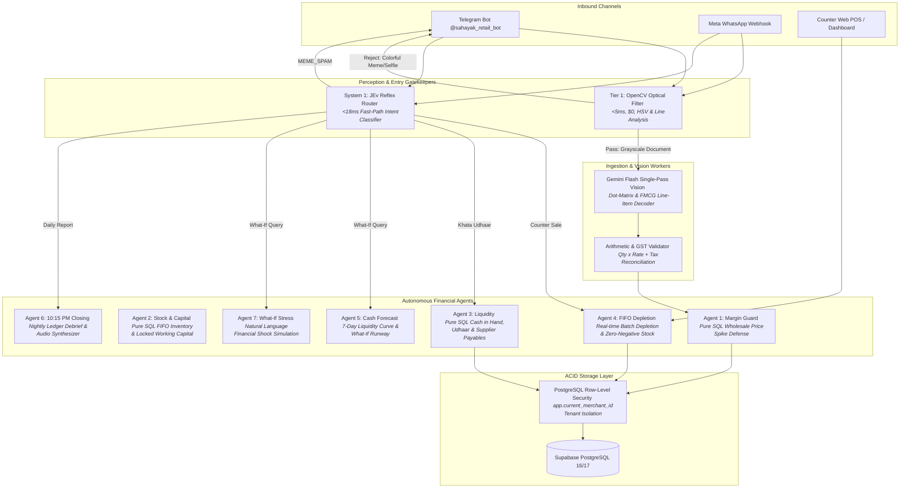

# Sahayak (सहायक) — Autonomous Retail & Wholesale Copilot

> **Enterprise-Grade AI Business Copilot for Indian Kirana & Small Retail Dukandaars.**  
> Built with zero-hallucination deterministic SQL ledgers, Row-Level Security (RLS), real-time FIFO stock depletion, OpenCV optical gatekeeping, and multimodal Gemini Vision OCR.

---

## 🏛️ System Architecture



---

## 📂 Production Directory Layout

```
finance/
├── .env.example              # Environment variables template
├── .gitignore                # Git exclusion patterns
├── pyrightconfig.json        # Python type checking configuration
├── pytest.ini                # Pytest framework settings
├── requirements.txt          # Core application dependencies
├── requirements-worker.txt   # Vision AI & worker dependencies
├── README.md                 # Master production documentation
├── init_db.py                # Database table initialization & RLS setup
├── test.md                   # Sample invoice text fixture
│
├── app/                      # Production Application Package (Zero Code Modification)
│   ├── __init__.py
│   ├── main.py               # FastAPI entry-point, lifespan & Telegram polling daemon
│   │
│   ├── api/                  # Inbound API Routers & Gateway
│   │   ├── deduplication.py  # Microsecond perceptual media deduplication (<1ms)
│   │   ├── notifier.py       # WhatsApp & Telegram alert dispatchers
│   │   ├── routes.py         # Webhook endpoints (/webhook/telegram, /webhook/whatsapp)
│   │   └── security.py       # HMAC-SHA256 signature validation & auth guards
│   │
│   ├── core/                 # Shared Contracts & Settings
│   │   ├── config.py         # Application settings loaded via pydantic-settings
│   │   └── contracts.py      # Shared frozen Pydantic contracts & event schemas
│   │
│   ├── db/                   # Database Layer & Multi-Tenant RLS
│   │   ├── fifo_engine.py    # Agent 4 FIFO inventory depletion engine
│   │   ├── khata_models.py   # SQL models: CashTransaction, InventoryBatch, CustomerKhata
│   │   ├── khata_repository.py# Transactional database repository for sales & Udhaar
│   │   ├── margin_guard.py   # Agent 1 wholesale price spike detection logic
│   │   ├── models.py         # SQL models: Merchant, Supplier, Invoice, PriceHistory
│   │   ├── repository.py     # Inbound invoice persistence & merchant lookup
│   │   └── session.py        # Context-managed PostgreSQL RLS session provider
│   │
│   ├── services/             # Core Autonomous Business Agents
│   │   ├── analytics_agent.py # Debtor dossiers & analytical scorecards
│   │   ├── bot_service.py    # Omnichannel bot handler (Telegram & WhatsApp)
│   │   ├── closing_agent.py  # Agent 6: 10:15 PM shop closing debrief synthesizer
│   │   ├── copilot_llm.py    # Universal Gemini fallback with strict RLS scoping
│   │   ├── forecast_agent.py # Agent 5 & 7: 7-day cash forecast & what-if simulator
│   │   └── image_gatekeeper.py# Tier 1 OpenCV optical document filter (<5ms, $0)
│   │
│   └── workers/              # Perception & Task Workers
│       ├── config.py         # Vision & worker settings
│       ├── contracts.py      # Extracted invoice data contracts
│       ├── gemini_extractor.py# Gemini Vision single-pass extraction & OCR guardrails
│       ├── guardrails.py     # Arithmetic verification: Qty x Rate + Tax = Total
│       ├── jev_router.py     # System 1 JEv Reflex Router (<18ms intent classifier)
│       ├── preprocessor.py   # OpenCV deskew, contrast normalization & noise removal
│       ├── stt_engine.py     # Vernacular voice transcription (Sarvam AI / Whisper)
│       ├── tasks.py          # Celery asynchronous invoice ingestion task
│       └── voice_khata.py    # Indian shorthand & multilingual voice parser
│
├── frontend/                 # Client Web Application
│   ├── dashboard.html        # Interactive merchant financial dashboard
│   ├── index.html            # Landing page
│   ├── login.html            # Merchant authentication & 1-Click Telegram pairing
│   ├── css/                  # Styling & themes
│   └── js/                   # Dashboard logic, charts, and API client
│
├── simulator/                # Testing & Simulation Tools
│   ├── index.html            # Price-hike simulation tool
│   └── counter.html          # Web-based POS counter checkout
│
├── tests/                    # Automated Test Suite (Pytest)
│   ├── fixtures/             # Real paper bills & skewed image fixtures
│   ├── test_analytics_and_intent.py
│   ├── test_counter_gateway.py
│   ├── test_counter_math_validation.py
│   ├── test_database_rls.py
│   ├── test_five_core_agents.py
│   ├── test_gatekeeper_and_advisory.py
│   ├── test_gateway.py
│   ├── test_jev_stt.py
│   ├── test_khata_fifo_rls.py
│   ├── test_phase3_forecast.py
│   └── test_vision_worker.py
│
├── docs/                     # Production Architecture Documentation
│   ├── architecture/
│   │   ├── dataflow.md       # Complete sequence diagrams & dataflow specs
│   │   └── git.md            # Multi-device zero-conflict branch workflow
│   ├── phases/
│   │   ├── phase.md          # End-to-end hackathon master blueprint
│   │   ├── phase1.md         # Phase 1: Wholesale Bill Vision & Margin-Guard
│   │   ├── phase2.md         # Phase 2: Inflow Rails, Customer Khata & FIFO
│   │   └── phase3.md         # Phase 3: Liquidity Forecasting & Nightly Closing
│   └── laptops/
│       ├── 1lap1.md, 1lap2.md, 1lap3.md # Laptop 1 Domain Specifications
│       └── 2lap1.md, 2lap2.md, 2lap3.md # Laptop 2 & 3 Domain Specifications
│
└── scratch/                  # Developer Scratchpad & Integration Test Scripts
```

---

## 🤖 The 7 Autonomous Retail Agents

| Agent | Name | Type | Latency | Core Responsibility | Example Commands |
| :--- | :--- | :--- | :--- | :--- | :--- |
| **Agent 1** | **Margin Guard** | Pure SQL | `<8ms` | Detects wholesale price hikes (>3%) and calculates exact shelf repricing. | `/margin`, `/simulate` |
| **Agent 2** | **Stock & Capital** | Pure SQL | `<12ms` | Computes active FIFO shelf valuation and alerts on dead / low stock (≤5 units). | `/stock`, `/capital` |
| **Agent 3** | **Liquidity** | Pure SQL | `<10ms` | Aggregates settled cash in hand, customer Udhaar receivables, and distributor payables. | `/liquidity`, `/cash` |
| **Agent 4** | **FIFO Depletion** | Pure SQL | `<15ms` | Depletes oldest inventory batches on counter sales with zero-negative stock protection. | `Paytm 300 Oil 2` |
| **Agent 5** | **Cash Forecast** | Pure SQL + Math | `<25ms` | Projects 7-day cumulative liquidity curve taking into account customer repayment delays. | `/forecast 7`, `/runway` |
| **Agent 6** | **10:15 PM Closing** | LLM + SQL | `<1.2s` | Generates nightly shop debrief: daily inflow, top-selling SKUs, and margin alerts. | `/closing`, `/1015` |
| **Agent 7** | **What-If Stress** | LLM + Simulation| `<850ms` | Stress-tests financial shocks (e.g. rent coverage, supplier payments, cheque bounce). | `/whatif Agar kal ITC ko 15000 du toh?` |

---

## 🚀 Quickstart Guide

### 1. Prerequisites
- Python 3.11+
- PostgreSQL 16 or 17 (Supabase recommended)
- Redis 7+ (for deduplication cache & Celery task broker)

### 2. Environment Setup
```bash
# Clone and enter directory
cd finance

# Install production dependencies
pip install -r requirements.txt
pip install -r requirements-worker.txt

# Configure environment
cp .env.example .env
# Edit .env with your DATABASE_URL, TELEGRAM_BOT_TOKEN, and GEMINI_API_KEY
```

### 3. Database Table & RLS Initialization
```bash
python init_db.py
```

### 4. Running the Application
```bash
# Start FastAPI Server with Telegram Long-Polling Worker
python -m uvicorn app.main:app --host 0.0.0.0 --port 8000
```

### 5. Accessing Services
- **Merchant Web Dashboard:** `http://localhost:8000/dashboard.html`
- **Store Onboarding & Telegram Pairing:** `http://localhost:8000/login.html`
- **Interactive POS Counter:** `http://localhost:8000/counter.html`
- **API Health Check:** `http://localhost:8000/api/health`
- **Telegram Bot:** `@sahayak_retail_bot`

---

## 🧪 Running Automated Tests

```bash
# Run complete test suite (82+ unit, integration & RLS tests)
python -m pytest tests/ -v

# Run entry-point optical gatekeeper test
python -m scratch.test_entry_gatekeeper
```

---

## 🔒 Security & Multi-Tenant Isolation

- **PostgreSQL Row-Level Security (RLS):** Every database session executes `SET LOCAL app.current_merchant_id = '...'`. PostgreSQL kernel enforces that no tenant can read, insert, or update another store's records.
- **Microsecond Perceptual Deduplication:** Redis perceptual SHA-256 caching drops duplicate invoice uploads in `<1ms`.
- **Zero-LLM Gatekeeping:** Colorful memes and random non-bill images are dropped locally via OpenCV in `~3.4ms` without consuming API tokens or polluting the database ledger.
